# הרצת המשחק

תחילה מוצגת מפת רומא והשחקן צריך לבחור במיקום אליו ללכת לחפש את הקרדינל שנחטף, על פי הרמז בפינה.
בחירה שגויה מפחיתה מהזמן שיהיה להציל את הקרדינל(עקב הזמן שבוזבז על הליכה למקום הלא נכון).
בחירה במיקום הנכון פותחת את הרמה עצמה ומתחילה את הטיימר.
ברמה עצמה השחקן צריך להגיע לקרדינל ולנסות להצילו בזמן(בשלב זה הרוצח משתמש ב"יסוד האדמה" כדי להרוג אותו).

# יחסי המחלקות# ארכיטקטורה ויחסי מחלקות (Class Relationships)

## 1. תיאור קצר של יחסי המחלקות

המערכת בנויה בארכיטקטורה מונחית אירועים (Event-Driven) המפרידה בין **לוגיקת המשחק והפיסיקה**, **ניהול נתונים ומצב**, ו-**ממשק המשתמש (UI)**:

* **שכבת התשתית והנתונים (`ScriptableObject`):**
  * **ערוצי אירועים (`VoidEventChannelSO`, `FloatEventChannelSO`):** מתווכים בין משדרים למאזינים ללא הפניות ישירות ביניהם[cite: 7, 9].
  * **קונפיגורציה ומצב (`LevelConfigSO`, `LevelData`):** `LevelConfigSO` שומר פרמטרים קבועים לשלב (`startingTime`, `wrongMapPenalty`, `rockHitPenalty`)[cite: 8], בעוד `LevelData` משמש לאחסון מצב הריצה הדינמי של השלב (`isGateOpen`, `isCardinalSafe`, `isPlayerDead`, `isTimeUp`) ומעביר אותו מסצנת המשחק (`Level1Scene`) לסצנת הסיום (`GameResults`)[cite: 11, 12, 13, 18, 20].
* **שכבת ניהול השלב והממשק:**
  * `MapRiddleController` מנהל את חידת המיקום הפותחת; בחירה נכונה משדרת אירוע להתחלת השלב (`levelStartedChannel`), ובחירה שגויה משדרת קנס זמן (`timePenaltyChannel`) מתוך `LevelConfigSO`[cite: 19].
  * `LevelTimer` מאזין לתחילת השלב ולקנסות הזמן, מעדכן בכל פריים את `TimerUIView` דרך `timeUpdatedChannel`, ובסיום הזמן מעדכן את `LevelData` ומעביר לסצנת `GameResults`[cite: 18, 21].
  * `showResults` קורא את הדגלים מ-`LevelData` בסצנת הסיום, מציג את סיבת הניצחון/הפסד, ומאפס את הנתונים (`ResetData()`) בעת התחלת משחק חדש[cite: 20].
* **שכבת השחקן והאינטראקציות בעולם:**
  * `PlayerController` מנהל תנועה, קפיצה ומניעת החלקה במדרגות, ומחשוף אירוע אינטראקציה מקומי (`UnityEvent onInteract`)[cite: 17].
  * אובייקטי הסביבה האינטראקטיביים (`AngelInteractor`, `gateOpener`, `CardinalLifter`) מזהים כניסת שחקן (`OnTriggerEnter2D`), נרשמים זמנית ל-`onInteract` של `PlayerController`, ומפעילים את הלוגיקה שלהם (סיבוב מראה ושחרור סלע, פתיחת שער, או הצלת הקרדינל ומעבר לסצנת הסיום)[cite: 10, 11, 13].
  * **מכשולים ופיסיקה:** `StairSwitch` מבטל התנגשות מול המדרגות העליונות (`Physics2D.IgnoreCollision`) למעבר חלק בין המפלסים[cite: 16]; `PlayerDetector` מזהה את השחקן באמצעות `Physics2D.Raycast` ומפעיל `UnityEvent`[cite: 14]; `SpawnedStone` נע על המדרגות, משדר קנס זמן (`stoneHittedPlayer`) בפגיעה בשחקן ומשדר `stoneDestroyedChannel` בהשמדתו[cite: 15]; ו-`FallingDetector` מזהה נפילה לתהום ומסיים את המשחק[cite: 12].

---

## 2. תרשים מחלקות (UML Class Diagram)

```mermaid
classDiagram
    class MonoBehaviour
    class ScriptableObject

    %% ScriptableObjects & Data
    class VoidEventChannelSO {
        +UnityAction OnEventRaised
        +RaiseEvent()
    }
    class FloatEventChannelSO {
        +UnityAction~float~ OnEventRaised
        +RaiseEvent(float value)
    }
    class LevelConfigSO {
        +float startingTime
        +float wrongMapPenalty
        +float rockHitPenalty
    }
    class LevelData {
        <<Shared Data>>
        +bool isGateOpen
        +bool isCardinalSafe
        +bool isPlayerDead
        +bool isTimeUp
        +ResetData()
    }

    ScriptableObject <|-- VoidEventChannelSO
    ScriptableObject <|-- FloatEventChannelSO
    ScriptableObject <|-- LevelConfigSO
    ScriptableObject <|-- LevelData

    %% Core Controllers & UI
    class PlayerController {
        +UnityEvent onInteract
        -VoidEventChannelSO levelStartedChannel
        -EnableControl()
        +StartInteract()
    }
    class LevelTimer {
        -LevelConfigSO levelConfig
        -LevelData levelData
        -VoidEventChannelSO levelStartedChannel
        -FloatEventChannelSO timePenaltyChannel
        -FloatEventChannelSO timeUpdatedChannel
        -VoidEventChannelSO timeExpiredChannel
        -StartTimer()
        -ApplyPenalty(float)
        -timeUp()
    }
    class MapRiddleController {
        -LevelConfigSO levelConfig
        -FloatEventChannelSO timePenaltyChannel
        -VoidEventChannelSO levelStartedChannel
        +SelectLocation(int)
    }
    class TimerUIView {
        -FloatEventChannelSO timeUpdatedChannel
        -UpdateDisplay(float)
    }
    class showResults {
        -LevelData levelData
        +playAgain()
    }

    %% World Interactions & Hazards
    class AngelInteractor {
        -GameObject player
        +correctMirror()
    }
    class gateOpener {
        -GameObject player
        -LevelData levelData
        +openGate()
    }
    class CardinalLifter {
        -GameObject player
        -LevelData levelData
        +LiftCardinal()
    }
    class FallingDetector {
        -LevelData levelData
    }
    class PlayerDetector {
        -UnityEvent OnPlayerDetect
    }
    class SpawnedStone {
        -float stoneHitPlayerTimePenality
        -VoidEventChannelSO stoneDestroyedChannel
        -FloatEventChannelSO stoneHittedPlayer
    }
    class StairSwitch {
        -Collider2D upperStairsCollider
    }

    MonoBehaviour <|-- PlayerController
    MonoBehaviour <|-- LevelTimer
    MonoBehaviour <|-- MapRiddleController
    MonoBehaviour <|-- TimerUIView
    MonoBehaviour <|-- showResults
    MonoBehaviour <|-- AngelInteractor
    MonoBehaviour <|-- gateOpener
    MonoBehaviour <|-- CardinalLifter
    MonoBehaviour <|-- FallingDetector
    MonoBehaviour <|-- PlayerDetector
    MonoBehaviour <|-- SpawnedStone
    MonoBehaviour <|-- StairSwitch

    %% Event Channel Relationships (Broadcast & Listen)
    MapRiddleController ..> VoidEventChannelSO : raises (levelStarted)
    VoidEventChannelSO ..> PlayerController : notifies (EnableControl)
    VoidEventChannelSO ..> LevelTimer : notifies (StartTimer)

    MapRiddleController ..> FloatEventChannelSO : raises (timePenalty)
    SpawnedStone ..> FloatEventChannelSO : raises (stoneHittedPlayer)
    FloatEventChannelSO ..> LevelTimer : notifies (ApplyPenalty)

    LevelTimer ..> FloatEventChannelSO : raises (timeUpdated)
    FloatEventChannelSO ..> TimerUIView : notifies (UpdateDisplay)

    LevelTimer ..> VoidEventChannelSO : raises (timeExpired)
    SpawnedStone ..> VoidEventChannelSO : raises (stoneDestroyed)

    %% Local UnityEvent & Direct Interactions
    AngelInteractor --> PlayerController : subscribes onInteract
    gateOpener --> PlayerController : subscribes onInteract
    CardinalLifter --> PlayerController : subscribes onInteract
    StairSwitch ..> PlayerController : ignores collision
    SpawnedStone ..> PlayerController : detects collision
    FallingDetector ..> PlayerController : detects trigger

    %% Data & Config References
    LevelTimer --> LevelConfigSO : reads startingTime
    MapRiddleController --> LevelConfigSO : reads wrongMapPenalty
    LevelTimer --> LevelData : sets isTimeUp
    FallingDetector --> LevelData : sets isPlayerDead
    gateOpener --> LevelData : sets isGateOpen
    CardinalLifter --> LevelData : reads isGateOpen / sets isCardinalSafe
    showResults --> LevelData : reads flags & ResetData()
```

---

## 3. מיפוי אירועים: שולחים ומקבלים

| שם האירוע / הערוץ | סוג המנגנון | שולח (Broadcaster / Invoker) | מקבל / מאזין (Listener) | פעולה מתבצעת |
| :--- | :--- | :--- | :--- | :--- |
| `levelStartedChannel` | `VoidEventChannelSO` | `MapRiddleController`[cite: 19] | `PlayerController`[cite: 17], `LevelTimer`[cite: 18] | פתיחת שליטה לשחקן (`EnableControl`) והתחלת ספירת הטיימר (`StartTimer`)[cite: 17, 18]. |
| `timePenaltyChannel` | `FloatEventChannelSO` | `MapRiddleController`[cite: 19] | `LevelTimer`[cite: 18] | הפחתת שניות קנס (`wrongMapPenalty`) מהזמן הנותר (`ApplyPenalty`)[cite: 18, 19]. |
| `stoneHittedPlayer` | `FloatEventChannelSO` | `SpawnedStone`[cite: 15] | `LevelTimer` *(דרך נכס הערוץ המשותף ב-Inspector)*[cite: 18] | הפחתת שניות קנס (`stoneHitPlayerTimePenality`) בעת פגיעת אבן בשחקן[cite: 15, 18]. |
| `timeUpdatedChannel` | `FloatEventChannelSO` | `LevelTimer`[cite: 18] | `TimerUIView`[cite: 21] | עדכון תצוגת השעון בפורמט `MM:SS` על המסך (`UpdateDisplay`)[cite: 21]. |
| `timeExpiredChannel` | `VoidEventChannelSO` | `LevelTimer`[cite: 18] | *(מוגדר להרחבה ב-Inspector)* | שידור התראה שהזמן נגמר (במקביל למעבר הסצנה מתוך `LevelTimer.timeUp()`)[cite: 18]. |
| `stoneDestroyedChannel` | `VoidEventChannelSO` | `SpawnedStone`[cite: 15] | *(מוגדר ב-Inspector / Spawner חיצוני)* | התראה שאבן הושמדה (יצאה מהגבול או פגעה בשחקן) לצורך מחזוריות יצירת האבנים[cite: 15]. |
| `onInteract` | `UnityEvent` (ב-`PlayerController`)[cite: 17] | `PlayerController`[cite: 17] | `AngelInteractor`[cite: 10], `gateOpener`[cite: 13], `CardinalLifter`[cite: 11] | הרשמה והסרה דינמית של פעולת האינטראקציה לפי הקרבה לאובייקט (`Trigger`)[cite: 10, 11, 13]. |
| `OnPlayerDetect` | `UnityEvent` (ב-`PlayerDetector`)[cite: 14] | `PlayerDetector`[cite: 14] | *(מוגדר ב-Inspector)* | הפעלת טריגר סביבתי כאשר קרן ה-`Raycast` מזהה את השחקן[cite: 14]. |

---

## 4. החלטות ארכיטקטורה (Architecture Decisions)

### 1. ערוצי אירועים מבוססי ScriptableObject (Event Channels) במקום הפניות ישירות
* **מה נבחר:** שימוש בנכסי `ScriptableObject` (`VoidEventChannelSO`, `FloatEventChannelSO`) כמתווכים לפי תבנית **Observer** בין לוגיקת המשחק, הטיימר וה-UI (למשל `MapRiddleController` ו-`SpawnedStone` משדרים קנסות זמן, `LevelTimer` מעבד אותם ומשדר עדכון ל-`TimerUIView`)[cite: 7, 9, 15, 18, 19, 21].
* **מה הייתה החלופה:** הפניות ישירות (`Direct References` / `GetComponent` / `Singleton`) שבהן האבן או חידת המפה מחזיקות הפניה ישירה ל-`LevelTimer`, ו-`LevelTimer` מחזיק הפניה ישירה לרכיב הטקסט `TextMeshProUGUI`.
* **למה נבחרה גישה זו:** מניעת צימוד הדוק (Loose Coupling) בין מחלקות בסצנה, אפשרות לחבר משדרים ומאזינים בגרירה ב-Inspector ללא תלות בהיררכיה, ויכולת להוסיף מקורות קנס חדשים בלי לשנות שורת קוד ב-`LevelTimer` או ב-UI.

### 2. ניהול מצב המשחק והגדרות שלב באמצעות נכסי נתונים (`LevelData` ו-`LevelConfigSO`)
* **מה נבחר:** הפרדת הנתונים מהאובייקטים שבסצנה אל תוך נכסי `ScriptableObject`: `LevelConfigSO` לשמירת פרמטרים של איזון השלב (`startingTime`, `wrongMapPenalty`, `rockHitPenalty`)[cite: 8], ו-`LevelData` לשמירת מצב הריצה (`isGateOpen`, `isCardinalSafe`, `isPlayerDead`, `isTimeUp`) בין סצנת המשחק (`Level1Scene`) לסצנת הסיום (`GameResults`)[cite: 11, 12, 13, 18, 20]. *(הערה: במחלקה `SpawnedStone` הוגדר בנוסף שדה מקומי `stoneHitPlayerTimePenality` לכוונון פרטני של קנס האבן ב-Prefab[cite: 15]).*
* **מה הייתה החלופה:** מחלקת מנהל בשיטת **Singleton** עם `DontDestroyOnLoad` שנשמרת בין סצנות, או שימוש במשתנים סטטיים (`static`) / `PlayerPrefs`.
* **למה נבחרה גישה זו:** מניעת בעיות אתחול וכפילויות אובייקטים בעת טעינה מחדש של הסצנה, שמירה על עקרון האחריות היחידה (SRP), ויכולת לאפס את כל מצב השלב בצורה מפורשת ונקייה דרך `levelData.ResetData()` בלחיצה על משחק חוזר[cite: 20].

### 3. רישום דינמי לאירועי אינטראקציה מקומיים (`UnityEvent` + Triggers)
* **מה נבחר:** חשיפת `public UnityEvent onInteract` ב-`PlayerController`[cite: 17], כך שכל אובייקט אינטראקטיבי בעולם (`AngelInteractor`, `gateOpener`, `CardinalLifter`) נרשם אליו ב-`OnTriggerEnter2D` ומסיר את עצמו ב-`OnTriggerExit2D`[cite: 10, 11, 13]. בנוסף, זיהוי חציית המדרגות ב-`PlayerDetector` מבוצע מקומית באמצעות `Physics2D.Raycast` ו-`UnityEvent`[cite: 14].
* **מה הייתה החלופה:** ניהול מרכזי בתוך `PlayerController` שבודק בכל לחיצת כפתור אילו אובייקטים נמצאים ליד השחקן בעזרת תגיות (`CompareTag`) ושרשרת תנאי `if/else`.
* **למה נבחרה גישה זו:** עמידה בעקרון הפתוח-סגור (Open/Closed Principle) — מחלקת השחקן אינה מכירה כלל את החידות, השערים או הפסלים שבשלב, וכל אובייקט בעולם אחראי בלעדית על ההתנהגות שלו כשהשחקן בקרבתו..

# איך מוסיפים סוג אויב או חפץ חדש: אילו קבצים משתנים
המחלקה StoneSpawner - אם נרצה להשתמש בקובץ בשביל ליצור אינסטנסים מסוג אחר פשוט נגרור בחלון הINSPECTOR של האובייקט שמכיל את הסקריפט, את ה PREFAB הרלוונטי 
לשדה ה prefabToSpawn

